# TrendScope AI

**Social media trend intelligence and event discovery** — a local web application that finds what is trending in a set of tweets, groups them into topics, tracks each topic's life cycle, measures sentiment, evaluates the algorithms on labelled data, and raises alerts.

TrendScope AI is built on top of the original *Twitter Trending Topic Detection and Analysis* pipeline (University of Plymouth internship, April–June 2018; see [Original pipeline](#original-pipeline-2018)). It runs entirely on your machine, needs **no Twitter/X credentials and no paid services**, and ships with a reproducible synthetic demo.

> **Academic prototype.** Synthetic data is generated, uploaded data is unverified, and live X retrieval is optional and has never been run against the real API on the development machine. The interface labels the data source of every analysis.

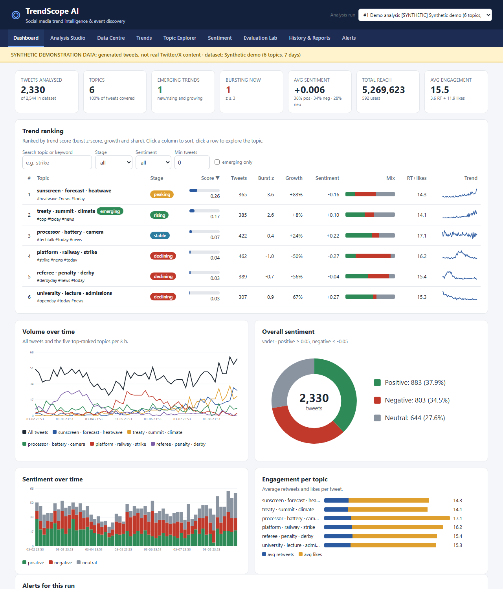

## Contents
1. [Features](#features)
2. [The nine modules](#the-nine-modules)
3. [How the analysis works](#how-the-analysis-works)
4. [Installation (Windows PowerShell)](#installation-windows-powershell)
5. [Run the application](#run-the-application)
6. [Using your own data (CSV / JSON / JSONL)](#using-your-own-data-csv--json--jsonl)
7. [Synthetic demo](#synthetic-demo)
8. [Tests](#tests)
9. [Architecture and technology](#architecture-and-technology)
10. [Optional models and the X API](#optional-models-and-the-x-api)
11. [Screenshots](#screenshots)
12. [Known limitations and future work](#known-limitations-and-future-work)
13. [Original pipeline (2018)](#original-pipeline-2018)

## Features

| Area | What it does | Status |
|---|---|---|
| Trend detection | Burst z-score and Poisson p-value, growth, velocity, composite trend score | Implemented, tested |
| Topic life cycle | `new`, `rising`, `peaking`, `stable`, `declining`, `inactive`, plus an *emerging* flag | Implemented, tested |
| Topic discovery | Original document-pivot method and TF-IDF K-Means (pure Python) | Implemented, tested |
| Sentiment | VADER (default) and the Hu & Liu opinion lexicon; experimental emotion counts | Implemented, tested |
| Data Centre | CSV / JSON / JSONL upload with field mapping, validation and duplicate detection; synthetic generator | Implemented, tested |
| Model Evaluation Lab | Accuracy, precision, recall, F1, confusion matrix, purity, ARI, timing, manual annotation | Implemented, tested |
| History | Saved runs, saved configurations, side-by-side comparison, deletion | Implemented, tested |
| Reports | Topic CSV, per-tweet CSV, full JSON and a standalone HTML report | Implemented, tested |
| Alerts | Six configurable rule types, evaluated after every run | Implemented, tested |
| SentiStrength | Needs Java on `PATH` | Optional; only tested with a fake process |
| Transformer sentiment, sentence-embedding topics, BERTopic | Need extra packages and model downloads | Optional; only tested with fakes, never run here |
| Live X API v2 search | Needs your own bearer token | Optional; only tested with a fake HTTP layer, never run here |

## The nine modules

The interface is a single-page app (hash-routed tabs). The **Analysis run** selector at the top switches every tab to a stored run, and a coloured banner always states the data source: **yellow = synthetic**, **grey = uploaded**, **green = live X**.

| # | Tab | Purpose |
|---|---|---|
| 1 | **Dashboard** | Seven KPIs (tweets, topics, emerging, bursting now, average sentiment, reach, engagement), a sortable and filterable trend ranking with sparklines, volume over time, overall and over-time sentiment, engagement per topic, and the alerts raised by the run. |
| 2 | **Analysis Studio** | Choose a dataset and configure an analysis: keyword, hashtag and exclusion filters, date range, languages, minimum followers, duplicate removal, sentiment algorithm and thresholds, topic algorithm and its parameters, time-bin size, burst threshold. Configurations can be saved and reloaded. |
| 3 | **Data Centre** | Upload CSV / JSON / JSONL, map columns, preview validation results, import as an *uploaded* dataset; generate synthetic datasets with custom topics, shapes (steady, emerging, declining, burst) and sentiment mixes; inspect rows; optional live X search. |
| 4 | **Trends** | Trend discovery: life-cycle stage per topic, burst z-scores and p-values, growth and velocity, earlier bursts, and a topic comparison chart. |
| 5 | **Topic Explorer** | Pick a topic to see its top terms, hashtags, example posts, sentiment and evolution over time. |
| 6 | **Sentiment** | Overall and per-topic sentiment, sentiment over time, and the experimental emotion counts. |
| 7 | **Evaluation Lab** | Score sentiment classifiers and topic algorithms against labelled data (see [below](#model-evaluation-lab)). |
| 8 | **History & Reports** | List, select, compare and delete saved runs; download topic CSV, tweet CSV, JSON and HTML reports. |
| 9 | **Alerts** | Create, edit, enable, disable and delete alert rules; browse recent alert events. |

## How the analysis works

An analysis runs this pipeline: **filters → duplicate removal → sentiment → topics → time series → trend intelligence → alerts**. The result is stored in SQLite, so every tab, export and comparison reads the same saved numbers.

### Trend detection
- **Burst z-score** = (mean of the last *w* bins − baseline mean) / max(baseline std, √baseline mean); the **p-value** is the Poisson tail.
- **Growth** compares recent bins with the bins before; the **trend ramp** is a smoother growth over a longer window.
- **Time bins** are anchored to the end of the data, so recent bins are always complete.
- **Trend score** = 0.5 × burst + 0.3 × growth + 0.2 × share of tweets.
- **Emerging** = rising or new, and a burst, growth of +100 % or a ramp of +50 %.

### Topic life cycle
Re-evaluated at every bin. A slope counts only if it is more than two standard errors from zero.

| Stage | Meaning |
|---|---|
| `new` | First seen in the last two bins, after silence |
| `rising` / `declining` | Significant slope over the recent window (declining also if the level fell below half its peak by more than 2 Poisson standard deviations) |
| `peaking` | Neither rising nor declining, and clearly above the topic's own earlier level |
| `stable` | Neither rising nor declining, and not clearly above its earlier level |
| `inactive` | No recent activity |

The rules are deliberately conservative so noise on a small topic is not read as a trend. Full definitions are in [TRENDSCOPE.md](TRENDSCOPE.md).

### Sentiment
Scores are normalised to [-1, 1]. A tweet is *positive* at or above the positive threshold, *negative* at or below minus the negative threshold, otherwise *neutral* (default thresholds 0.05; a score of exactly 0 is always neutral).

| Algorithm | Notes |
|---|---|
| `vader` (default) | Understands negation and intensity ("not good" is negative); English only |
| `lexicon` | Hu & Liu opinion lexicon, `(pos − neg) / (pos + neg)`; counts polar words and ignores negation |
| `sentistrength` | Optional, runs an externally installed SentiStrength jar through Java (not included; see [SENTISTRENGTH.md](SENTISTRENGTH.md)) |
| `transformer` | Optional, Hugging Face `transformers` pipeline |

**Emotions** are experimental: whole-word matches against a small hand-written lexicon; negation is not understood.

### Topic algorithms

| Algorithm | Notes |
|---|---|
| `pivot` | The original `topicDetection.py` method (TF-IDF and cosine similarity). Quadratic: slow above ≈1,500 tweets |
| `kmeans` (default) | TF-IDF and K-Means in pure Python, k-means++ seeding with restarts, silhouette-based choice of k when `k` is 0 |
| `embeddings` | Optional, `sentence-transformers` embeddings with spherical k-means |
| `bertopic` | Optional, BERTopic |

### Model Evaluation Lab
Metrics are computed **only from real predictions against real labels** and never invented; an algorithm that cannot run reports an error instead of a score.

- **Sentiment:** accuracy, per-class precision / recall / F1, macro averages, 3×3 confusion matrix, processing time. At least 20 labelled tweets are required.
- **Topics:** purity, adjusted Rand index (ARI), coverage, number of clusters, processing time. At least 30 labelled tweets over two or more topics are required.
- **Label sources:** the synthetic generator's ground truth, a `label_sentiment` / `label_topic` column in your upload, or tweets you annotate manually in the lab.
- Results are stored and listed under *Past evaluations*. Scores on synthetic data are optimistic because its text is templated.

### History, reports and alerts
- **History:** every run stores its configuration, dataset, data source and full result. Runs can be compared (KPI deltas and keyword-based topic matching) or deleted (alert events go with them). Runs saved by earlier versions still load.
- **Reports** (History & Reports tab, or `GET /api/runs/<id>/export?format=…`):

| Format | `format=` | Contents |
|---|---|---|
| Topic ranking CSV | `topics.csv` | Rank, stage, tweets, score, burst z, p-value, growth, sentiment counts, engagement, first / last seen, keywords |
| Per-tweet CSV | `tweets.csv` | Tweet, time, language, sentiment label and score, assigned topic (needs the dataset to still exist) |
| JSON | `json` | Run metadata, dataset, source, configuration and the full result |
| HTML report | `html` | Standalone page with the data-source banner, dataset, run, algorithms, period, KPIs, ranking and configuration |

  CSV cells that start with `=`, `+`, `-`, `@`, tab or CR are prefixed with an apostrophe to prevent spreadsheet formula injection; stored data is not changed.
- **Alerts** are evaluated after every run. Each event is stored once per rule, message and run.

| Rule type | Fires when |
|---|---|
| `burst` | A topic's burst z-score ≥ *z* and size ≥ *min size* (defaults 4.0 and 15) |
| `negative_share` | A topic's negative share ≥ *share* and size ≥ *min size* (0.6 and 30) |
| `sentiment_drop` | A topic's average sentiment ≤ *avg* and size ≥ *min size* (−0.4 and 30) |
| `volume` | A topic has at least *size* tweets (300) |
| `emerging_count` | At least *count* emerging topics (1) |
| `overall_negative` | The overall negative share ≥ *share* (0.5) |

  Three rules (burst, negative share, emerging) are created the first time the database is made; deleted rules do not come back.

## Installation (Windows PowerShell)

Requirements: **Windows**, **Python 3** (developed and tested with Python 3.15.2) and a browser. The browser tests need Chrome or Edge.

```powershell
cd C:\KIT-GITHUB-Project\Trending-Topic\twitter-trending-topics
python -m venv .venv
.venv\Scripts\python -m pip install nltk
.venv\Scripts\python -c "import nltk; nltk.download('vader_lexicon')"
```

The core application uses the Python standard library plus **NLTK** (tweet tokenizer, Porter stemmer and the VADER lexicon). The older plotting scripts additionally use `matplotlib`, `python-twitter` and `pymongo` (see [DEMO.md](DEMO.md)); TrendScope itself does not need them. There is no `requirements.txt`. If the VADER lexicon is missing, the app still starts and reports VADER as unavailable with this install command.

Bundled data used offline: `opinionLexicon\` (Hu & Liu word lists). The SentiStrength jar and data are **not** distributed with this repository; see [SENTISTRENGTH.md](SENTISTRENGTH.md) for the optional setup.

## Run the application

```powershell
cd C:\KIT-GITHUB-Project\Trending-Topic\twitter-trending-topics
.venv\Scripts\python trendscope.py
```

This opens **http://localhost:8765** (the next free port is used if 8765 is busy). On the first run it seeds a synthetic demo dataset and one analysis, so the dashboard is never empty. Stop it with `Ctrl+C`.

| Option | Effect |
|---|---|
| `--port 9000` | Choose the port |
| `--host 127.0.0.1` | Bind address (default `127.0.0.1`, local only) |
| `--db <path>` | Use another SQLite file (default `trendscope_data\trendscope.db`) |
| `--no-demo` | Start with an empty database |
| `--no-browser` | Do not open a browser tab |

Data lives in `trendscope_data\trendscope.db`. Delete that file to start fresh.

## Using your own data (CSV / JSON / JSONL)

1. Open **Data Centre**, choose a file (`.csv`, `.json`, `.jsonl` or `.ndjson`) and click preview.
2. TrendScope guesses the column mapping (you can change it). Delimiters `, ; tab |` are detected; a `.json` file may be a JSON array or one object per line, including raw Twitter API tweet objects.
3. The preview reports valid rows, exact and near duplicates and rows with bad timestamps. Only valid rows are imported.
4. Give the dataset a name and import. It is stored as an **uploaded** dataset (grey banner) and is never modified by later analyses.

| Field | Required | Typical column names recognised |
|---|---|---|
| `text` | **yes** | `text`, `full_text`, `content`, `tweet`, `message`, `body` |
| `timestamp` | **yes** | `created_at`, `timestamp_ms`, `timestamp`, `date`, `datetime`, `time` |
| `id`, `user`, `followers`, `retweets`, `likes`, `lang` | no | `id`, `screen_name`, `followers_count`, `retweet_count`, `favorite_count`, `lang` … |
| `label_sentiment` | no | `label_sentiment`, `sentiment_label`, `sentiment`, `label` — values such as `positive` / `negative` / `neutral` (also `pos`, `neg`, `+`, `-`, `1`, `-1`) |
| `label_topic` | no | `label_topic`, `topic_label`, `topic` |

Add the label columns if you want fair evaluation scores in the Evaluation Lab. Limits: at most 20,000 rows per dataset and 80 MB per upload; analyses are capped by the *max tweets* setting (default 2,500).

Example CSV:

```csv
id,created_at,text,lang,likes,retweets,label_sentiment
1,2025-03-03 09:15:00,Trains are cancelled again at the station,en,3,1,negative
2,2025-03-03 09:40:00,Great news on the climate summit treaty today,en,12,4,positive
```

## Synthetic demo

No credentials are needed.

- **In the app:** the first start creates *Synthetic demo (6 topics, 7 days)* — about 2,500 generated tweets (including retweets and noise) with a fixed seed (42), covering a burst, two emerging topics, a steady topic and declining topics — and runs an analysis on it. On an empty dashboard the **Quick start** button creates the same thing.
- **Your own synthetic data:** Data Centre → *Generate*: choose the number of tweets, days, seed, noise, difficulty and your own topics with their keywords, shape and sentiment mix. Generated tweets carry ground-truth sentiment and topic labels for the Evaluation Lab.
- **Older one-page demo:** `.venv\Scripts\python demo.py` builds a static `demo\out\dashboard.html` with the original pipeline (details in [DEMO.md](DEMO.md); it needs `matplotlib`, `python-twitter` and `pymongo` installed as listed there).

Synthetic data is always bannered in yellow and in reports as *"SYNTHETIC DEMONSTRATION DATA: generated tweets, not real Twitter/X content"*.

## Tests

```powershell
.venv\Scripts\python -W ignore -m unittest discover -s tests
.venv\Scripts\python tests\run_ui_tests.py
.venv\Scripts\python tests\capture_ui.py
```

| Command | What it runs |
|---|---|
| `unittest discover -s tests` | **230** unit and API tests across `tests\test_trendscope.py`, `test_trends_stage3.py`, `test_stage4_nlp.py` and `test_stage5.py` / `test_stage6.py` (about 1–2 minutes) |
| `tests\run_ui_tests.py` | **35** browser tests that drive the real UI in headless Chrome or Edge (set the `CHROME` environment variable if it is installed in an unusual place) |
| `tests\capture_ui.py` | Screenshots of every tab (desktop and phone width) into `screenshots\`, plus console-error and horizontal-overflow checks |

All tests use temporary databases and synthetic data; they never download models, call X, or touch `trendscope_data\`. Run one module with, for example, `.venv\Scripts\python -W ignore -m unittest tests.test_stage5 -v`.

## Architecture and technology

**Stack:** Python standard library (`http.server`, `sqlite3`, `csv`, `json`) with NLTK for tokenising, stemming and VADER; a dependency-free front end (plain HTML, CSS and JavaScript with hand-written SVG charts). No web framework, no build step, no JavaScript libraries.

```
trendscope.py            launcher (port, database, demo seeding)
trendscope/
  server.py              HTTP server and JSON API (/api/...), static files
  engine.py              filters, pipeline, run comparison, configuration validation
  trends.py              burst, growth, velocity, life-cycle stages, score
  topics.py              pivot, kmeans, optional embeddings / BERTopic
  sentiment.py           VADER, lexicon, SentiStrength, transformer, emotions
  datacentre.py          parsing, mapping, validation, duplicates, synthetic generator
  evaluation.py          accuracy, precision, recall, F1, confusion, purity, ARI
  db.py                  SQLite: datasets, configs, runs, annotations, evals, alerts
  reports.py             CSV, JSON and HTML exports
  alerts.py              alert rule types and evaluation
  xapi.py                optional X API v2 recent search
  static/                index.html, app.js, style.css (the dashboard)
tests/                   unit/API tests, browser tests, screenshot capture
screenshots/             interface screenshots used below
trendscope_data/         trendscope.db (created on first run)
topicDetection.py, topicUtils.py, opinionLexicon.py, sentiStrength.py, stopwords.py   original pipeline reused by TrendScope
main.py, stream.py, dashboard.py, demo.py, plot*.py                                  original command-line tools
```

The server binds to `127.0.0.1` by default and has no authentication; do not expose it to a network.

## Optional models and the X API

Nothing below is installed or downloaded automatically. When a package is missing, the algorithm is shown as unavailable in the interface with the reason, and choosing it anyway gives a clear error (HTTP 400) — never fabricated results.

| Optional feature | Requirement | Verified how |
|---|---|---|
| SentiStrength sentiment | Java on `PATH` and a separately downloaded SentiStrength jar ([setup](SENTISTRENGTH.md)) | Integration code tested with a fake process; never run with real Java here |
| Transformer sentiment | `pip install transformers torch` (model downloaded on first use) | Fake pipeline only |
| Embedding topics | `pip install sentence-transformers` | Fake model only |
| BERTopic | `pip install bertopic sentence-transformers` | Fake package only |
| Live X search | Your own X API v2 bearer token in the `X_BEARER_TOKEN` environment variable, set **before** starting the app | Fake HTTP layer only; never called against X |

```powershell
$env:X_BEARER_TOKEN = "<your token>"      # only for live retrieval; never type it into the page
.venv\Scripts\python trendscope.py
```

Live retrieval uses `GET https://api.x.com/2/tweets/search/recent` (last 7 days; your plan's limits and per-read costs apply). The token is read from the environment only; it is never stored, logged or accepted from the browser. Live data is shown with a green banner.

## Screenshots

| | |
|---|---|
| 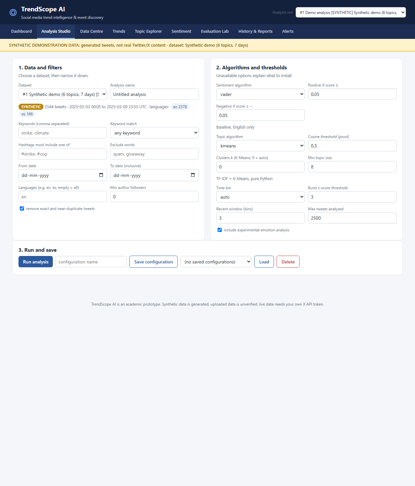 **Analysis Studio** | 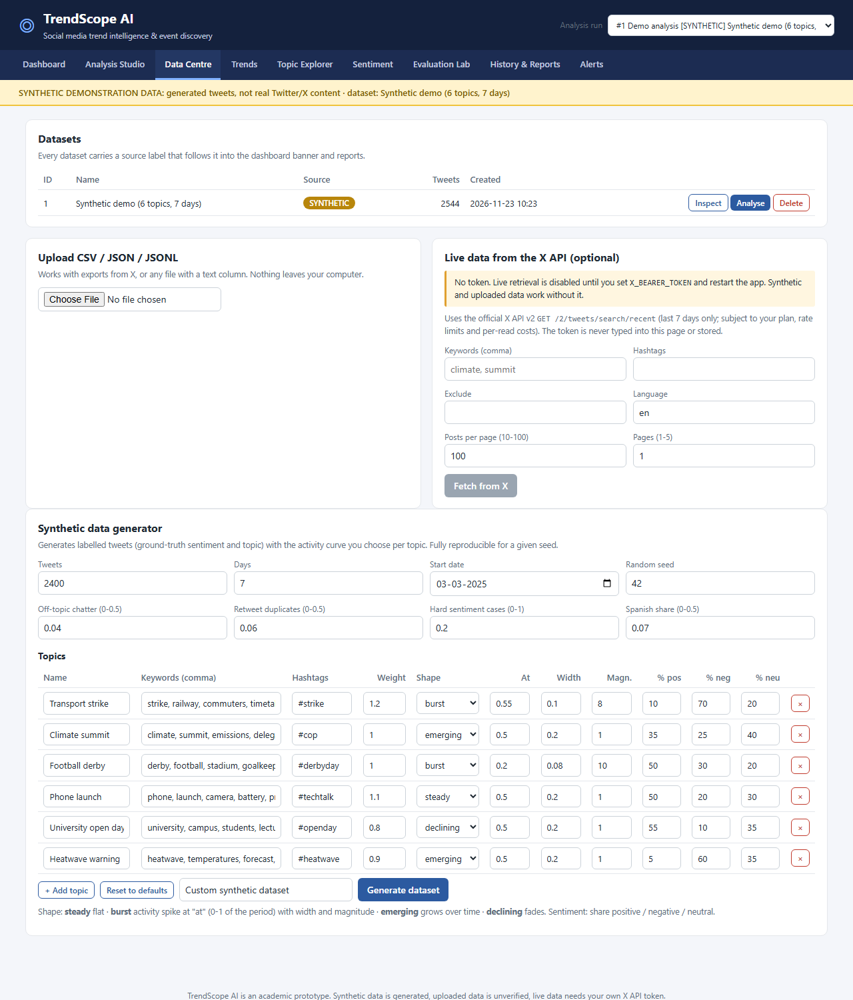 **Data Centre** |
| 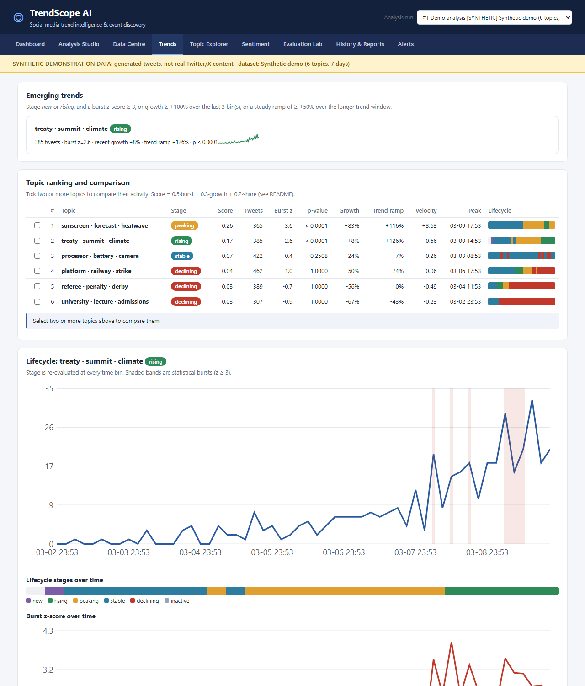 **Trend discovery** | 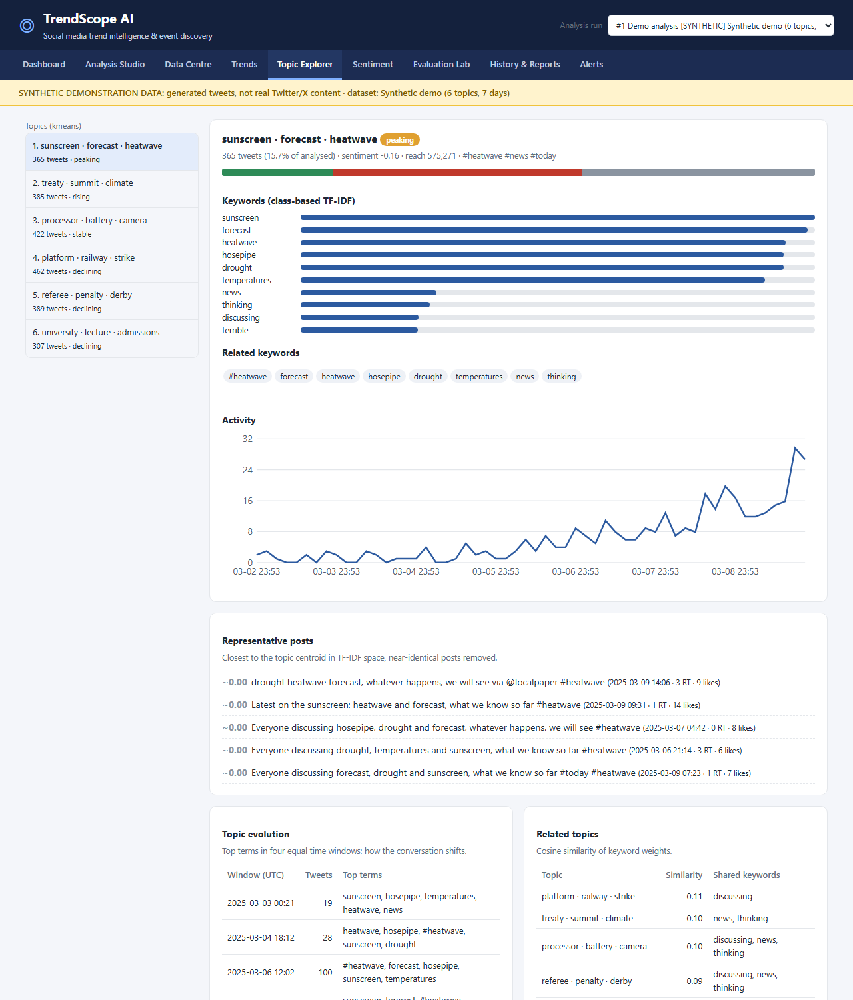 **Topic Explorer** |
| 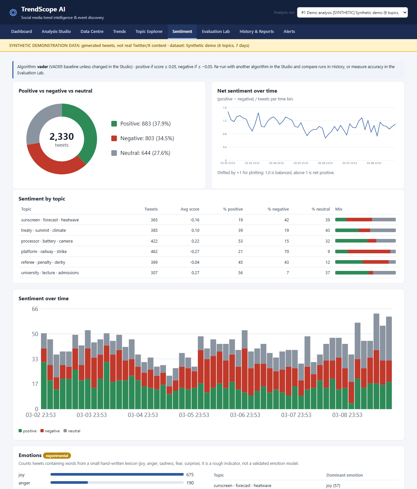 **Sentiment** | 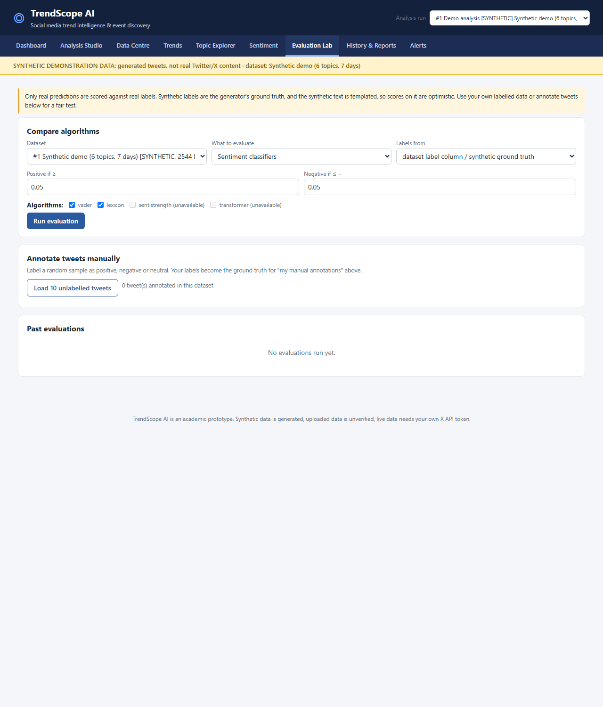 **Evaluation Lab** |
| 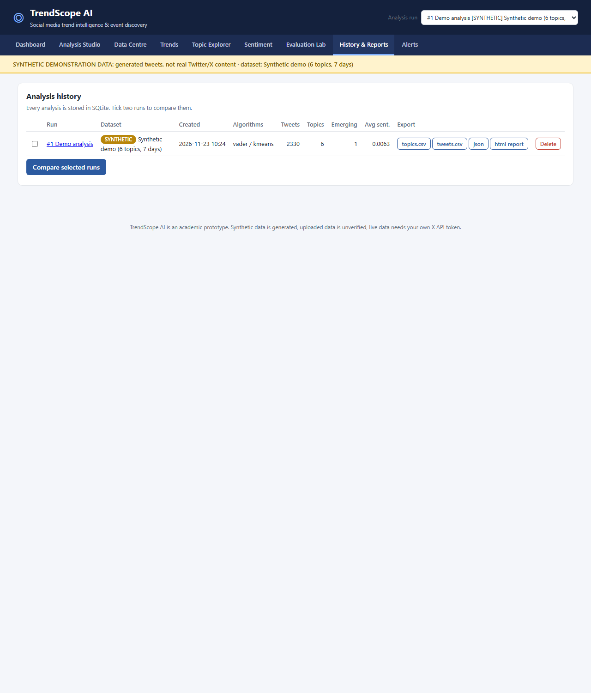 **History & Reports** | 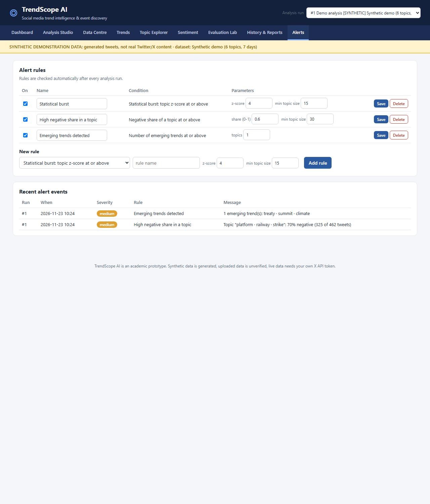 **Alerts** |

| Uploaded data (grey banner) | Empty state | Phone width |
|---|---|---|
| 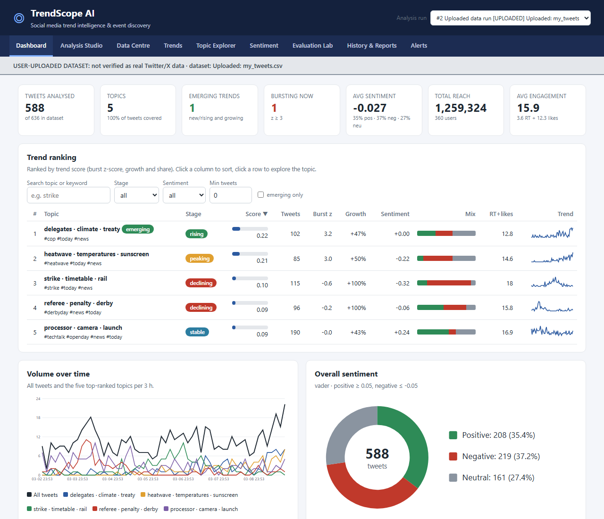 | 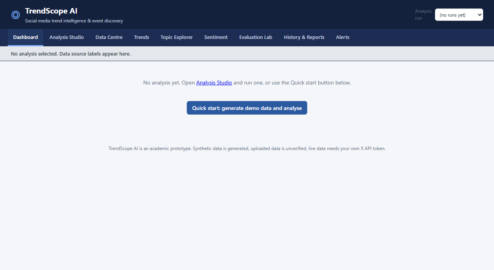 | 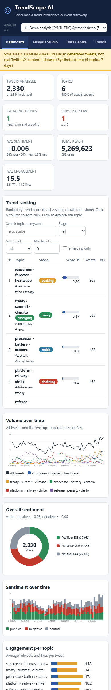 |

Regenerate them with `.venv\Scripts\python tests\capture_ui.py`.

## Known limitations and future work

**Limitations**
- Live X retrieval and the real SentiStrength, transformer, sentence-transformers and BERTopic models have never been run on the development machine; only the integration code is tested, with fakes.
- The original `pivot` topic method is quadratic and slow above about 1,500 tweets; `kmeans` is the default.
- Synthetic text is templated, so evaluation scores on it are optimistic.
- VADER and the lexicon are English only; the emotion analysis is a small hand-written lexicon without negation handling.
- Growth over a single time bin is noisy for small topics (for example +100 % beside a `declining` stage); the stage uses a significance-tested slope, so trust the stage.
- Alerts are evaluated per run, so re-running the same data raises its alerts again.
- Phone-width layouts were checked in headless Chrome only (no real devices). The server has no authentication and is meant for local use.
- No `requirements.txt`; dependencies are listed in [Installation](#installation-windows-powershell).

**Possible future work** (not implemented)
- Real-model benchmarks once the optional packages are installed and tested.
- Multilingual sentiment and topic models.
- Scheduled live retrieval and notifications (e-mail or webhooks) for alerts.
- A `requirements.txt`, authentication and multi-user support.

## Original pipeline (2018)

This repository originated from code written during an internship at the University of Plymouth (United Kingdom), April–June 2018, associated with the article by Dr. Marco Palomino for the conference SOMET 2018 (http://secaba.ugr.es/SOMET2018/). The command-line tools remain available:

* retrieve tweets (`stream.py`, via `main.py -r`)
* group tweets in topics (`topicDetection.py`, via `main.py -a`)
* analyse tweets to generate graphs (all `plot*.py`)

### How to retrieve tweets
`python3 main.py --help` gives:

```
Twitter trending topics detection and analysis
==============================================

Usage:
	main.py [-l <number>] -r <choice>
	main.py [-t <number>] [-s <number>] -a <tweets file> <output directory>

--help, -h
	Display this help message

--retrieve, -r [filter <term1 term2 ...> | news [date]]
	Get tweets from Twitter to STDOUT.
	‘filter <terms>’ streams a live sample 10,000 tweets, filtered by given terms, if any
	‘news’ streams a live sample of tweets from UK news sources’
	‘idsfile <fname>’ will retrieve tweets whose IDs are specified in given file, one per line
	Default: get a sample of the whole of Twitter without filters

--limit, -l <number>
	Indicate the number of tweets you want to retrieve with ‘filter’. Default: 10,000
	0 or a negative value means no limit. In this case stop with ^C.

--analyze, -a <tweets file> <output directory>
	Given a tweets file, this will generate, in the output directory:
	topics.json, containing all topics
	summary.txt, containing a more human-readable summary of topics
	stats.csv,   containing tweetCount, views and tfidf, etc. for each topic (TAB seperated values)
	sentimentStats.json, containing numbers of positive, negative, neutral and total tweets

--threshold, -t <number>
	Set the cosine similarity threshold between tweet and topics.
	Values can range from 0.1 to 0.9. Default: 0.3

--size, -s <number>
	Set the minimum number of tweets in a topic.
	Default: 5
```

Retrieval uses the 2018 Twitter streaming API with keys in `twitterApiHandle.py`; it has not been tested on this machine. **Never commit real keys** (`twitterApiHandleWithSecret.py` is git-ignored).

### Analyse the topics
Use a `plot*.py` file, set the configuration on top with your values, and run `python3 plotSomething.py`. If there is no error, this generates a plot and numerical values on `stdout`.

### Used external software
**Python 3**, programming language and standard library, https://docs.python.org/3/

**MongoDB** (unused), database server, https://docs.mongodb.com/manual/installation

**PyMongo** (unused), MongoDB database client for Python, https://api.mongodb.com/python/current/index.html

**NewsAPI**, news headlines retrieval service, https://newsapi.org

**Matplotlib**, Python 2D plotting library, https://matplotlib.org

**Twitter API**, documentation of the official Twitter API, https://developer.twitter.com/en/docs

**python-twitter**, Python wrapper for the Twitter API, https://github.com/bear/twitter-python

**SentiStrength**, sentiment rating program, http://sentistrength.wlv.ac.uk/

**VaderSentiment**, rule-based sentiment rating Python library, https://github.com/cjhutto/vaderSentiment.
Citation: Hutto, C.J. & Gilbert, E.E. (2014). VADER: A Parsimonious Rule-based Model for Sentiment Analysis of Social Media Text. Eighth International Conference on Weblogs and Social Media (ICWSM-14). Ann Arbor, MI, June 2014.

**Opinion Lexicon**, two lists of terms, positive and negative, http://www.cs.uic.edu/~liub/FBS/sentiment-analysis.html.
Citation: Minqing Hu and Bing Liu. "Mining and Summarizing Customer Reviews." Proceedings of the ACM SIGKDD International Conference on Knowledge Discovery and Data Mining (KDD-2004), Aug 22-25, 2004, Seattle, Washington, USA

**Node.js ‘stopwords’ package**, a list of 661 stopwords which includes the SMART stopwords list, https://github.com/huned/node-stopwords

**Natural Language ToolKit (NLTK) Tweet Tokenizer**, a text tokenizer specifically made for tweets, http://www.nltk.org/api/nltk.tokenize.html#module-nltk.tokenize.casual

**NLTK implementation of Porter Stemmer**, a standard word stemming algorithm, http://www.nltk.org/api/nltk.stem.html#module-nltk.stem.porter.
Citation: Porter, M. "An algorithm for suffix stripping." Program 14.3 (1980): 130-137.

## License
See [LICENSE](LICENSE).
